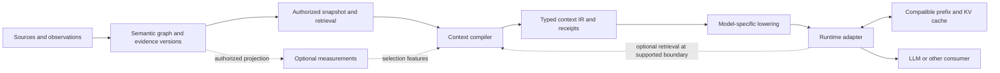

# Tunic architecture

Status: target architecture, 2026-10-31. A bounded [W1 reference slice](w1-reference.md) implements local Python evidence ingestion, snapshots, impact queries, and a versioned JSON context profile. A [local continuation adapter](continuation-reference.md) also renders evidence and executes supported segments. Shipped beyond W1: methods/self-receiver extraction, document mentions with an [evidence-precision gate](evidence-qualification.md), typed claims with retrieval policies, file-level incremental refresh with full-rebuild equivalence, a persistent agent-memory API, an MCP stdio boundary, local-embedding hybrid retrieval with a digest-keyed vector cache, a [knowledge policy contract](policy-contract.md), a versioned [graph schema](graph-schema.md), registry-dispatch and callback-parameter candidate proposals with derivation chains, and frozen precision/arena benchmarks with corpus manifests. The [evidence selection](evidence-selection.md) layer is implemented and opt-in (`select=True`): deterministic structural rules over fused candidates with per-decision traces. Measured on the frozen suites it improves retrieval F1 while keeping recall, and its corroboration is retraction-aware (a fully retracted edge contributes no support). Model-facing text rendering additionally separates OBSERVED / ASSERTED / CORRECTIONS / DISPUTED / WITHHELD evidence with a truncation receipt. Frozen evaluation lives in benchmarks/precision (mention split), benchmarks/memory, benchmarks/agent, and benchmarks/arena (semantic runs, audit notes). Prefetch, KV-cache fusion, multi-user authorization, and distributed operation remain unfinished. The Frontier Ledger keeps unresolved observations with structured proof receipts, kind-dispatched replay, regression export, audited `retrieval_miss` records with rank-based predicates, and read-only triage prioritization (clusters, three queues, heuristic ranking with sensitivity passes, digest-anchored mutation check). Acquisition is measured by the frozen ACQ v1 suite (10 scenarios × 5 reps × 3 arms). The single authoritative progress tracker is [implementation-status.md](implementation-status.md); architecture docs describe contracts and targets and must not restate completion. Decision dispositions are maintained in [decisions](decisions.md); [glossary](glossary.md) defines shared terms.

## Purpose and first slice

Tunic is a shared evidence and context substrate. It preserves explicit source assertions and history, selects the evidence a task needs, and emits a reusable typed context IR for model-specific lowering. GraphGraph is prior art, with no compatibility obligation; its [audit](../references/graphgraph-audit.md) supplies lessons, not requirements.

The proposed first vertical slice is source-faithful code/text evidence through the W1 code-impact workload. W2 temporal decisions and W3 session resumption extend the same contracts. Their definitions and V/G/T comparison arms live in [workloads](../evaluation/workloads.md). The prototype must not depend on external project integrations or sophisticated geometry to function.

## Logical boundaries and authority

| Owner | State and contract | Boundary |
| --- | --- | --- |
| Semantic graph | [Sources, assertions, identity, time, provenance, snapshots](semantic-graph.md) | Owns durable evidence state; no model-specific entity identity. |
| Context compiler | [Context units, derivations, obligations, selection receipts](context-ir.md) | Owns task-specific selection/reconciliation; cannot rewrite source history. |
| Lowering and runtime adapter | [Rendered/token input, execution identity, cache handles](runtime.md) | Owns model compatibility and disposable computation; cannot silently remove required premises. |
| Optional measurement layer | [Measurement and research-object semantics](measurements.md) | Supplies derived features/hypotheses; cannot promote scores into factual authority. |

These are responsibility boundaries, not mandatory services, processes, crates, or databases. Retrieval/planning is a compiler responsibility over graph-owned views. Storage/indexing implements the graph contract without dictating claim semantics.

The optional [runtime memory controller](runtime-memory.md) schedules additional compiler requests at supported generation boundaries. It remains within the runtime owner; it does not bypass typed IR or establish arbitrary mid-layer injection. [Security](security.md) owns external authorization, framing, tool-execution, cache-isolation and revocation boundaries. Those model-backed/shared-runtime requirements are not implemented by the local W1 slice.

## End-to-end request

1. Resolve a committed source/graph/schema/policy snapshot, access scope, temporal selectors, and coverage/index readiness.
2. Retrieve candidates with explicit channel and work bounds. Record candidate-universe dependencies, not only selected records.
3. Select and reconcile evidence against query obligations and a declared planning budget. Preserve relevant conflicts and unknowns.
4. Validate evidence identity and required-premise closure, then publish immutable model-independent IR plus a selection/validation receipt.
5. Lower for a pinned target profile, tokenize the complete rendered input, and record exact costs and unit/source mappings.
6. Execute with ordinary prefill or verified compatible reuse. Return artifacts/receipts and explicit complete/partial/failure outcomes.

The planning policy can be informed by a target model's capacity. Model-independent IR means its fields/identity are independent of token/KV representations; it does not promise one evidence selection fits every model. If a target cannot fit an artifact, lowering fails explicitly or requests a newly identified compilation.

Source-span validity and schema checks are mechanical. Entailment and factual truth require separately scoped evidence/assumptions; a provenance chain alone proves neither. Hypotheses may be included as labeled proposals, not as facts.

## Change and reuse

Source versions, assertion history, and schema/policy decisions are authoritative. Derived graph views, indexes, selection artifacts, rendered inputs, and KV state are different reuse layers with different keys.

A change invalidates affected extraction/derivation artifacts. Selection additionally depends on newly eligible candidates, negative/absence conditions, ranking/index versions, scope, policy, and time. Conservative epoch invalidation/full recomputation is the reference. Narrower reuse requires a certificate for a restricted query class and equality with full compilation under the same semantics.

Unchanged IR content can retain its identity while a new snapshot produces a new validity receipt. Unchanged source text after a different prompt prefix generally cannot reuse its old exact KV state. Local graph edits do not imply local transformer recomputation. The [IR](context-ir.md) and [runtime](runtime.md) contracts own these details.

## Failure and recovery

Do not conflate empty, partial, stale, unsupported, unauthorized, invalid, and failed outcomes. A coverage gap is not proof of absence. Cancelled/interrupted compilation cannot publish validated partial artifacts. Recovery exposes a consistent committed view or explicitly unknown readiness. Cache loss permits recomputation without knowledge loss; revocation is rechecked before artifact or execution-state reuse.

## Validation and increments

The [evaluation strategy](../evaluation/strategy.md) owns common correctness and cost accounting; [workloads](../evaluation/workloads.md) owns task/arm definitions. Executed results live outside those two documents: W1/memory/agent suites run in-repo, and frozen results with manifests live in `benchmarks/precision` (mention split + runs), `benchmarks/memory`, `benchmarks/agent`, and `benchmarks/arena` (semantic runs, audit notes, scoreboard policy).

Order the work as: settle minimal graph/IR semantics and independent fixtures; implement a full-recompute source-to-IR-to-prompt slice; compare simple retrieval with graph selection; add verified incremental reuse; integrate a pinned runtime where supported. Numeric acceptance targets and concrete deployment choices remain open in [decisions](decisions.md).

## Conditional directions

The [geometry research](../research/geometry/README.md) investigates measurements, task-aware ranking, hypotheses, and controlled discovery. The [research assessment](../research/assessment.md) covers cache fusion, custom attention, and latent bridges. These remain experiments, not initial correctness dependencies.

The [runtime memory assessment](../research/runtime-memory.md) supports investigating boundary-triggered continuation and bounded prefetch, with caching as an independent factor. Non-prefix fusion and trained graph attention require separate quality/security tests and evidence that graph content affects results. A [bounded Ollama continuation path](continuation-reference.md) now runs, with [recorded smoke results](../evaluation/continuation-results.md); prefetch, custom attention and full runtime/security guarantees remain unimplemented.

Wilderbeast may supply code/analysis evidence, Chili Crisp may evaluate candidates, and Team Ops may consume shared evidence. No actual interfaces were audited. Each would need stable source/revision identity, evidence/status/coverage, reproducible artifacts, and explicit ownership. Tunic must work independently before integration is claimed.

For capability-level gaps and alternatives, use the [semantic graph research index](../research/semantic-graph/index.md). It does not override these contracts or turn every technique into a required feature.
