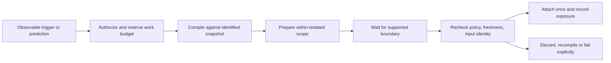

# Optional runtime memory controller

Status: experimental target with a bounded [local continuation implementation](continuation-reference.md). Supported segment boundaries and faithful rendering run; prefetch, active triggers and custom KV/latent mechanisms remain unimplemented. The [research assessment](../research/runtime-memory.md) supports a controller for retrieval at supported generation boundaries and bounded prefetch. It does not support arbitrary live activation injection as the default. The [runtime contract](runtime.md) continues to own execution compatibility and lowering; [security](security.md) owns trust and isolation.

## Ownership and capability boundary

“Runtime Memory Bridge” names a logical controller within the runtime adapter, not a mandatory new service or fourth source of semantic truth. The compiler still owns evidence selection and typed IR; the graph owns source snapshots. The controller owns when to ask for another artifact and whether a backend can expose it safely.

Its minimum capability is a supported message/segment continuation at a defined boundary. A fresh request with compatible prefix reuse is acceptable; mutable state inside an executing forward pass is not assumed. Hosted APIs may expose no logits, hidden states, or live KV mutation. Triggers use supported observable events or explicit retrieval requests, not presumed access to hidden reasoning.

Modes are independently declared: `segment_continuation`, `exact_prefix_reuse`, `nonprefix_fusion_experiment`, `trained_memory_experiment`. Supporting transfer or sparse attention does not imply support for any other mode. The last two need a pinned mechanism, separate quality tests and the research gates; they are not transparent fallbacks.

## Proposed request and receipt

A `MemoryRequest` carries session/request identity, principal/capability and policy epoch, current graph snapshot, exact query/obligations, observable trigger and boundary identity, mode, freshness policy, retrieval/token/work budgets, deadline and cancellation identity. A predicted request is explicitly speculative and cannot widen privileges.

The compiler returns validated IR and its selection receipt, or an explicit partial/failed/denied result. Model-specific preparation returns the [lowering receipt](runtime.md), including actual rendered prefix identity and a compatible cache reference when available. The controller's `AttachmentReceipt` binds those identities to the executed boundary, current authorization decision, evidence-exposure point, mode, discarded/recomputed extent and timing/resource observations. Authorization and compatibility are distinct checks.

These are target semantic fields, not a fully implemented API. The local profile records a narrower attachment receipt with snapshot/IR/render/profile identities and a fixed segment boundary; it has no authorization engine, cancellation protocol or distributed replay guarantee. The W1 CLI's “current snapshot” is only the last ingested snapshot; it does not monitor or certify freshness against the live filesystem.

## Lifecycle and freshness

States are requested, authorized, compiling, prepared, awaiting-boundary, attached, or a terminal denied/stale/cancelled/failed outcome. A boundary sequence plus artifact identity supplies idempotency: retries must not append duplicate evidence. Incomplete transfers/preparations never become usable state. Cancellation releases leases; crashed sessions cannot attach orphaned work after restart.

Choose either a pinned-snapshot session or a freshness-at-attachment policy. A timestamp-age limit alone cannot establish source/policy freshness. If the policy requires current evidence and an ingest/policy epoch changes, revalidate or recompile; no independence proof means full recompilation. Do not silently mix incompatible snapshots. Revocation must invalidate eligible preparations and future use; it cannot erase information already sent to a provider or emitted to a client.

Append through the backend's supported framing with unchanged preceding positions/masks to preserve compatible causal state. Insertion/reframing before processed tokens requires the backend's declared recomputation strategy. Record the exact reusable prefix rather than assuming message concatenation preserves it. Already emitted text remains historical output: buffer until grounded, regenerate before publication, or expose an explicit correction according to product policy. No implied retroactive repair.

On retrieval or cache failure, ordinary prefill is permitted only with the same authorized required evidence and a fitting budget. If evidence itself is unavailable, return an explicit failure/partial result under policy; do not silently proceed as if it had been supplied. Unsupported attachment fails capability negotiation or selects a separately identified supported request path.

## Prefetch policy

Start with bounded one-hop candidates from observable source/task events. Run access checks before querying, traversal and preparation, not after speculative reads. Preparation does not expose evidence to the model. Demand work has priority, and prefetch has explicit CPU/GPU/IO, memory, queue and deadline quotas; coalesce duplicates within an authorized isolation domain. Record unused/cancelled work as cost.

Recheck access and snapshot validity before attachment. Cache keys include policy/isolation and execution identities as appropriate, not just graph hashes. Release references and evict/revoke inaccessible work; stronger memory-erasure promises require an actual allocator/storage contract. Speculation is not a permission to precompute every reachable node.

## Adoption gates

The first experiment compares fixed-schedule upfront and boundary-triggered retrieval, then adds prefetch. Cross both with cache on/off and ordinary-prefill controls. Use the [research experiment protocol](../research/runtime-memory.md#measurable-experiments) and [security tests](security.md#required-tests-before-a-shared-or-model-backed-runtime).

Advance only with measured grounded task utility or resource savings at an explicit quality/security threshold. Non-prefix fusion needs quality/latency validation against full prefill. A learned bridge additionally needs graph-free and graph-swap interventions establishing graph use, held-out quality, and training cost accounting. The [local smoke results](../evaluation/continuation-results.md) establish a supported two-request path and reject unsupported model answers. They do not establish a performance advantage or complete these adoption gates.
