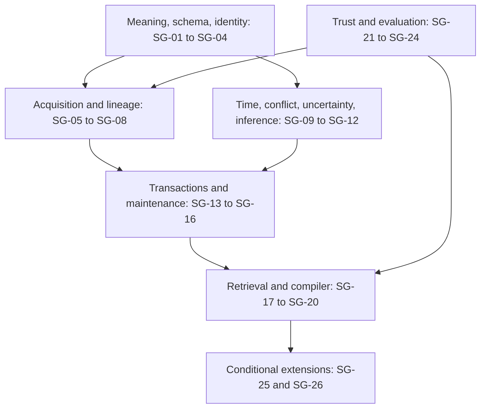

# Tunic semantic graph: capability and gap index

Research cutoff: **2026-10-30**. This is the entry point for what a usable Tunic semantic graph needs, what existing docs leave unresolved, and current research on each capability. It is a design/research index, not an implementation backlog with completed features.

Contract ownership: [semantic graph](../../architecture/semantic-graph.md), [context IR](../../architecture/context-ir.md), [runtime](../../architecture/runtime.md), and [decision register](../../architecture/decisions.md). This research index identifies remaining work; it does not override those contracts.

## Current state and scope

Tunic has architecture, mathematical sketches, a context IR proposal, workload plans, and reference-project assessments. It has no semantic graph engine or reproduced benchmark. Every capability below is unimplemented. **Draft** means its contract has an initial treatment in existing docs; **gap** means a substantial contract/decision is missing. Neither means working software.

The graph must represent **who asserted what, about which entity/event, under which scope and time, from which source, with what uncertainty and derivation**. Topology and vector similarity alone cannot supply those semantics.

The optional [geometry research extension](../geometry/README.md) explores versioned multidimensional measurements, typed reasoning paths, task-conditioned relevance, and first-class hypotheses/transformations. It builds on the indexed contracts; resistance, curvature, and learned utility do not replace provenance, temporal state, or correctness checks.

**Core** means required for the proposed first faithful code/text evidence slice. **Conditional** means required when the corresponding deployment/workload is introduced. **Experimental** means a candidate improvement to compare with simpler controls. Priorities are proposals derived from the three [workloads](../../evaluation/workloads.md), not mandates to implement every listed technique.

## Indexed capabilities

| ID | Capability / missing decision | Current design | Need | Research and acceptance discussion |
| --- | --- | --- | --- | --- |
| SG-01 | Proposition versus source assertion; events and qualified relations | Draft graph/IR; ontology profile unresolved | Core | [Representation](representation.md#sg-01-claims-events-and-qualifiers) |
| SG-02 | Ontology, constraints, and schema migration | Gap | Core | [Representation](representation.md#sg-02-ontology-and-constraints) |
| SG-03 | Persistent entity, assertion, revision, and artifact identities | Draft; wire contract unresolved | Core | [Representation](representation.md#sg-03-identity-and-canonicalization) |
| SG-04 | Literals, units, language, source coordinates, normalization | Draft fields; encoding/normalization unresolved | Core | [Representation](representation.md#sg-04-literals-and-source-coordinates) |
| SG-05 | Extraction pipeline and publication readiness | Draft lifecycle; producer profile unresolved | Core | [Acquisition](acquisition.md#sg-05-extraction-and-readiness) |
| SG-06 | Entity linking, ambiguous matches, reversible merge/split | Draft identity policy; algorithms unresolved | Core minimum; learned resolution experimental | [Acquisition](acquisition.md#sg-06-entity-resolution) |
| SG-07 | Claim-to-evidence and transformation lineage | Draft IR; entailment unresolved | Core | [Acquisition](acquisition.md#sg-07-evidence-and-lineage) |
| SG-08 | Coverage, omissions, completeness, and absence claims | Draft coverage contract; receipt schema unresolved | Core | [Acquisition](acquisition.md#sg-08-coverage-and-negative-evidence) |
| SG-09 | Bitemporal history, corrections, and unknown time | Draft temporal contract; operators unresolved | Core | [Knowledge state](knowledge-state.md#sg-09-temporal-state) |
| SG-10 | Contradictions, authority, and belief revision | Draft; resolution policy missing | Core | [Knowledge state](knowledge-state.md#sg-10-conflict-and-belief-revision) |
| SG-11 | Distinct uncertainty measures and calibrated abstention | Draft metadata only | Core labels; statistical models experimental | [Knowledge state](knowledge-state.md#sg-11-uncertainty-and-abstention) |
| SG-12 | Inference, premise support, and retraction | Draft support/retraction; rule profile unresolved | Core for derived claims; expressive reasoning conditional | [Knowledge state](knowledge-state.md#sg-12-inference-and-truth-maintenance) |
| SG-13 | Transactions, consistent reads, mutation log, recovery | Draft atomicity; concurrency/recovery profile unresolved | Core | [Maintenance](maintenance.md#sg-13-transactions-and-snapshots) |
| SG-14 | Incremental extraction, graph views, and index refresh | Draft objective only | Core correctness; optimization experimental | [Maintenance](maintenance.md#sg-14-incremental-maintenance) |
| SG-15 | Selection invalidation including unseen candidates | Draft; certificate unimplemented | Core conservative baseline | [Maintenance](maintenance.md#sg-15-selection-dependencies) |
| SG-16 | Artifact publication, replay, and lifecycle | Draft plus SmartMemory reference | Core local; distributed replay conditional | [Maintenance](maintenance.md#sg-16-artifacts-and-replay) |
| SG-17 | Lexical/dense/graph indexes and representation compatibility | Candidate methods only | Core baseline; advanced retrieval experimental | [Retrieval/compiler](retrieval-compiler.md#sg-17-indexes-and-fusion) |
| SG-18 | Typed query planning and bounded execution | Gap | Core | [Retrieval/compiler](retrieval-compiler.md#sg-18-query-planning) |
| SG-19 | Multiple resolutions, source diversity, summaries | Draft; fidelity/utility tradeoff unresolved | Core source grouping; generated summaries experimental | [Retrieval/compiler](retrieval-compiler.md#sg-19-resolution-and-diversity) |
| SG-20 | Typed context IR validation and model lowering | Draft contract | Core | [Retrieval/compiler](retrieval-compiler.md#sg-20-context-ir) |
| SG-21 | Authorization, derived-data scope, revocation | Draft; enforcement model missing | Core scope contract; multi-user enforcement conditional | [Trust/evaluation](trust-evaluation.md#sg-21-authorization) |
| SG-22 | Untrusted evidence and structural poisoning | Reference risks; threat model missing | Core trust labels; attack defenses experimental | [Trust/evaluation](trust-evaluation.md#sg-22-adversarial-evidence) |
| SG-23 | Interchange, federation, namespace and conflict ownership | Reference ideas only | Conditional | [Trust/evaluation](trust-evaluation.md#sg-23-interchange-and-federation) |
| SG-24 | Oracles, diagnostics, reproducibility, and economics | Draft workloads; no fixtures/results | Core | [Trust/evaluation](trust-evaluation.md#sg-24-evaluation-and-economics) |
| SG-25 | Runtime observations, cache compatibility, graph-guided KV | Draft adjacent layer | Conditional runtime; compression experimental | [Retrieval/compiler](retrieval-compiler.md#sg-25-runtime-boundary) |
| SG-26 | Multimodal grounding and evidence alignment | Gap | Conditional | [Acquisition](acquisition.md#sg-26-multimodal-grounding) |

## What the latest research changes

The linked notes compare current papers with established semantics and systems techniques. Key consequences are **proposed conclusions**, not measured Tunic results:

- Separate a proposition from individual source assertions; two sources saying the same thing are not necessarily independent evidence.
- Treat ontology and entity-resolution changes as versioned decisions with downstream invalidation.
- Carry query obligations through retrieval into exact supporting spans; a citation alone is not entailment.
- Maintain deletions and alternate supports, not only append new edges.
- Give simple relational/event indexes a fair comparison against global graph construction.
- Measure construction, updates, selection, and model execution separately.
- Keep attention-derived usage and inferred links distinct from verified semantic relations.

Sources include October 2026 uncertainty, SHACL, and threat-model work; newer does not mean more mature. [Source ledger](sources.md) records publication status, date, reading depth, and limitations. The sweep covers every indexed capability but is not an exhaustive review of every paper or a complete reading of the cited dissertation.

## Dependency and investigation order

First settle the minimal claim/event model, identity and scope rules, then create executable evidence fixtures and a full-recompute reference. Next establish source-faithful retrieval/IR and temporal queries. Optimize incremental work only against that oracle. Investigate inference breadth, distributed federation, multimodal extraction, and lossy runtime integration when a workload justifies them.

No storage engine or programming language is selected here. A property-graph implementation can adopt claim/provenance semantics without requiring RDF storage; citing RDF/SHACL does not establish conformance. Existing [tool candidates](../tools.md) remain candidates.

## Decision questions before implementation

1. What constitutes one assertion, its scope, and its evidence status?
2. Which types and predicates are accepted in the first code/text domain?
3. What exact time and completeness questions may the system answer?
4. What mutations publish atomically, and which derived artifacts can be stale?
5. What does the first workload's independent oracle establish?

Answer these in contracts and fixtures rather than adding another layer of architecture terminology.
